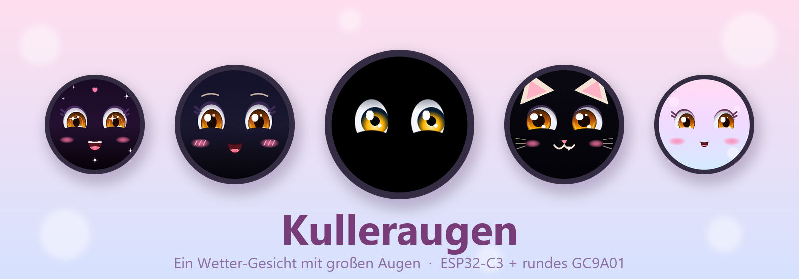

<p align="center">
  
</p>

<p align="center"><a href="README.md">English</a> · <b>Deutsch</b></p>

<p align="center">
  
  
  
  
</p>

Ein rundes GC9A01-Display am ESP32-C3 wird zu einem Gesicht mit großen Kulleraugen.
**Die Laune zeigt das Wetter.** Zwischendurch blendet es Uhrzeit und Vorhersage ein.

Alle Bilder auf dieser Seite sind echte Aufnahmen direkt aus dem Bildspeicher des Geräts.

## Launen

Das Wetter bestimmt die Laune, und die Irisfarbe folgt dem Wetter. Hier am Beispiel der Anime-Glanzaugen:

<table>
  <tr>
    <td align="center"><br><b>☀️ Sonne</b><br>fröhlich</td>
    <td align="center"><br><b>☁️ Wolken</b><br>gelangweilt</td>
    <td align="center"><br><b>🌧️ Regen</b><br>grimmig</td>
    <td align="center"><br><b>❄️ Schnee</b><br>zittert vor Kälte</td>
    <td align="center"><br><b>📡 kein WLAN</b><br>verwirrt</td>
  </tr>
</table>

## Gesichter

Ein Doppelklick auf den BOOT-Knopf wechselt zwischen fünf Gesichtern. Alle zeigen die Wetter-Laune.

<table>
  <tr>
    <td align="center"><br><b>0 · Kulleraugen</b><br>das ursprüngliche<br>Gesicht</td>
    <td align="center"><br><b>1 · Anime-Glanzaugen</b><br>große Glanzpunkte<br>und Wimpern</td>
    <td align="center"><br><b>2 · Chibi-Kätzchen</b><br>Öhrchen, Schnurrhaare<br>und Katzenmund</td>
    <td align="center"><br><b>3 · Sternenglitzer</b><br>Sternenaugen, Funkeln<br>und Herzchen</td>
    <td align="center"><br><b>4 · Pastell-Träumerchen</b><br>sanfter Pastell-<br>Verlauf</td>
  </tr>
</table>

## Hardware

- ESP32-C3 (z. B. ESP32-C3 DevKitM-1 oder SuperMini)
- Rundes GC9A01-Display, 240 × 240 Pixel, SPI

| Display | ESP32-C3 |
|---|---|
| SCL | GPIO 5 |
| SDA | GPIO 6 |
| DC | GPIO 2 |
| CS | GPIO 7 |
| RST | GPIO 3 |
| VCC | 3,3 V |
| GND | GND |

Die Pins lassen sich in `src/display.h` ändern.

## Aufspielen

Mit [PlatformIO](https://platformio.org/):

```
pio run -t upload
```

Benutzte Bibliotheken: [LovyanGFX](https://github.com/lovyan03/LovyanGFX),
[WiFiManager](https://github.com/tzapu/WiFiManager), [ArduinoJson](https://arduinojson.org/).
PlatformIO lädt sie automatisch.

## Erster Start

1. Das Display zeigt „Hallo!“ und öffnet das WLAN **Kulleraugen**.
2. Mit dem Handy verbinden; die Einrichtungsseite öffnet sich (sonst `192.168.4.1` aufrufen).
3. WLAN auswählen, Passwort und Wohnort (PLZ, Stadt oder ganze Adresse) eintragen, speichern.
4. Wird der Ort nicht gefunden, kommt die Einrichtung noch einmal.

Das Wetter kommt von [Open-Meteo](https://open-meteo.com/), der Ort wird über
[OpenStreetMap Nominatim](https://nominatim.org/) gesucht. Ein API-Schlüssel ist nicht nötig.

## BOOT-Knopf

| Bedienung | Wirkung |
|---|---|
| Doppelklick | nächstes Gesicht |
| 1,5–3 s halten, loslassen | Anzeige um 45° im Uhrzeigersinn drehen (acht Stufen) |
| 5 s halten (roter Ring ab 3 s) | Einstellungen löschen, Einrichtung startet neu |

Gesicht und Drehung bleiben nach einem Neustart erhalten.

## Für Entwickler

### Fotos und Bildrate

`python tools/snapshot.py COM23 bild.png [befehle]` holt ein Bild aus dem Gerät
(braucht `pyserial` und `Pillow`).

| Befehl | Wirkung |
|---|---|
| `f` | nächstes Gesicht |
| `m0` … `m4` | Laune erzwingen (fröhlich, gelangweilt, grimmig, frierend, verwirrt) |
| `w0` … `w3` | Wetter erzwingen (Sonne, Wolken, Regen, Schnee) |
| `x` | zurück zu echtem Wetter |
| `p` | Gesicht festhalten (keine Uhrzeit-/Vorhersage-Seiten) |

Alle 5 s kommt `FPS n` über die serielle Schnittstelle.

### Aufbau

```
src/            Hauptprogramm, Display, Wetter, Bildschirme
src/faces/      die Gesichter und ihr gemeinsamer Augen-Renderer
lib/logic/      hardwareunabhängige Logik (Knopf, Farbpaletten)
test/           Unity-Tests für lib/logic
tools/          snapshot.py
docs/           Konzept, Umsetzungsplan und Bilder
```

## Fehlersuche

- **Display bleibt nach dem Aufspielen schwarz und es kommen keine `FPS`-Zeilen:**
  Der Chip steht im Download-Modus. Ab- und wieder anstecken, ohne BOOT zu drücken.
- **Farben sehen falsch aus:** In `src/display.h` `cfg.invert` bzw. `cfg.rgb_order` umdrehen.

## Lizenz

[MIT](LICENSE)
